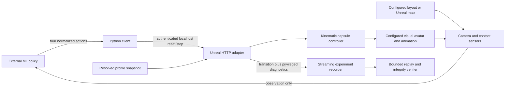

# 05 — Architecture, interfaces and modification points



## Source map

| Source | Responsibility / extension point |
| --- | --- |
| `erl/config.py` | Strict portable profile validation, mount resolution, canonical encoding and hashing |
| `erl/manage.py` | Local instance lifecycle, ports, tokens, isolated user directories, engine/asset doctor and inventory |
| `ResearchProfile.h/.cpp` | Runtime profile data and critical engine-side validation |
| `ResearchEnvironment.h/.cpp` | Capsule, sensors, HTTP contract, reset/step ordering, map travel and diagnostics |
| `ResearchHome.cpp` | Built-in home recipe, JSON instancing, reference lighting and supplied animation adapter |
| `scripts/prepare_assets.py` | Editor-only material creation, optional humanoid retarget recipe, local map fixture |
| `erl/client.py` | Validated actions, episode ordering and transport-uncertainty latch; policy Protocol |
| `erl/recorder.py` | Append-only transition/image files, provenance, bounded replay preview |
| `erl/verify.py` | Offline checksums, PNG integrity, paths and sequence/configuration verification |
| `erl/contract_check.py` | Profile-independent live diagnostic; not an ML policy |
| `erl/home_check.py`, `erl/smoke.py` | Layout-specific legacy diagnostics, with explicit supplied paths |
| `tests` | Python safety/configuration/integrity tests and separate real-browser QA |

The current adapters are modular source boundaries and configuration seams, not a complete dynamically loaded plugin marketplace. World reset/task/reward/motor providers beyond those boundaries require deliberate implementation and testing.

## Wire contract

See [the protocol](../PROTOCOL.md) and `docs/transition.schema.json`. All `/v1` routes require `X-ERL-Token`. API listeners bind to loopback. One controlling client must wait for each accepted mutation response before sending the next one.

Actions are `forward`, `strafe`, `turn`, `look`, exactly four finite numbers in [-1,1]. Translation is normalized so diagonal commands do not increase maximum speed. Rates and horizon come from the declared profile. Step duration remains 0.1 simulated seconds; look pitch stays bounded to [-70,70].

Policy observations contain ego PNG (or null in NullRHI), heading/look pitch/local displacement-derived velocity and blocked contact. These are supplied ideal sensors. Environment specification, seed, episode ID, world positions, obstacle position, observer/overview images and animation diagnostics are separate control/privileged data. Passing the full transition to an ML model would violate the default observation-only condition.

```python
from erl.manage import client_for

client = client_for('trial')
transition = client.reset(seed=42)
while not (transition['terminated'] or transition['truncated']):
    action = your_policy.act(transition['observation'])
    transition = client.step(action)
```

The policy returns `erl.client.Action`. Record model weights, version, prompts, pretraining and any diagnostic assistance yourself. The client seam supports different model frameworks without making those frameworks part of Unreal.

## Mutation and capture ordering

The server validates input/episode/step before moving. It applies one capsule sweep, updates supplied pose time, then defers reset/step response capture until the next engine tick so attached face/groom components can consume the pose. Pending observation/mutation calls return 503; health/spec remain available. This is serialization, not a full physics lockstep engine.

A timed-out mutation may have executed. The client blocks further steps after ambiguous transport outcomes and requires a fresh reset. Do not add automatic step retries. Error 409 means the episode/order is stale. Fix the controlling client's sequence or reset; do not guess a new expected step after an unknown result.

## What can change without recompilation

Profile values, mounted content roots, compatible avatar assets, prepared clip paths, capsule/camera placement, rates/horizon, JSON geometry, and the selected authored map can change between launches. An authored map's content is built in Unreal; new imported assets still need their proper engine processing/dependencies.

New action semantics, custom joint/torque control, new sensors, dynamic reset/task/reward providers, rig-specific Animation Blueprint variables and full simulation lockstep require code/adapters. Version incompatible observations/actions explicitly and keep old recorded conditions identifiable. Add features one at a time with separate automated and human gates.
